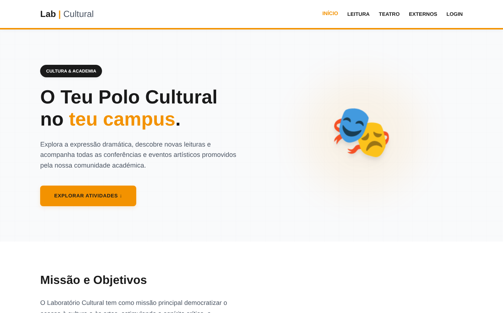
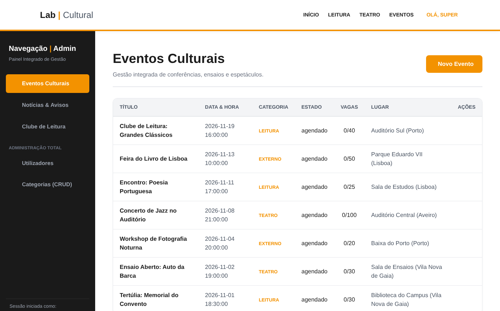
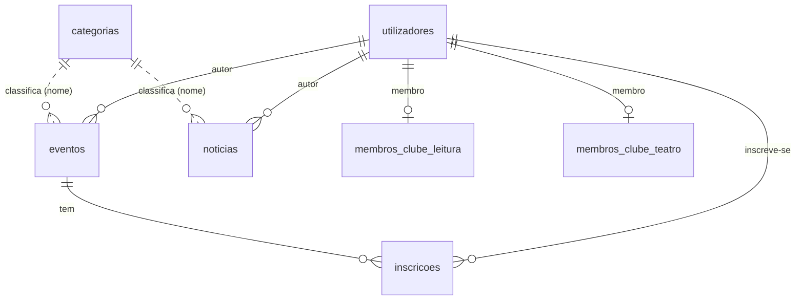

# Laboratório Cultural

Plataforma web para gerir e divulgar a atividade cultural de uma comunidade académica: **eventos, clube de leitura, clube de teatro e agenda de eventos externos**, com área pública (frontoffice) e área de gestão (backoffice) protegida por perfis.

> Projeto académico desenvolvido em dupla (João Pereira e Samuel Gomes) na unidade curricular de *Linguagens e Paradigmas de Programação* — Licenciatura em Engenharia Informática, ISPGAYA (2025/2026).
> Esta versão inclui uma revisão posterior de segurança e de qualidade de código (ver [O que foi melhorado](#o-que-foi-melhorado-após-a-entrega)).

## Pré-visualização

| Página inicial | Painel de administração |
|---|---|
|  |  |

## Funcionalidades

**Frontoffice**
- Home com próximos eventos, páginas dedicadas ao Clube de Leitura (com montra de livros) e ao Clube de Teatro.
- Agenda de eventos externos com filtros combinados (distrito, município, tipo e data), alimentada por um ficheiro JSON.
- Inscrição em eventos para utilizadores registados **e para convidados** (só com nome e e-mail), com controlo de vagas.
- Link "Adicionar ao Google Calendar" gerado para cada evento.
- Registo, login, perfil (edição de dados e palavra-passe, lista de inscrições) e inscrição nos clubes.

**Backoffice (por perfil)**

| Perfil | O que pode gerir |
|---|---|
| `super_admin` | Tudo: eventos, notícias, livros, utilizadores e categorias |
| `admin_leitura` | Eventos, notícias e livros do Clube de Leitura |
| `admin_teatro` | Eventos e notícias do Clube de Teatro |
| `aluno` | Sem acesso ao backoffice |

CRUD completo sobre eventos, notícias, livros, categorias e utilizadores, com janelas modais (JavaScript) sem recarregar a página.

## Stack

Python 3 · Flask · Jinja2 · MySQL/MariaDB (`mysql-connector-python`) · Flask-WTF (CSRF) · HTML/CSS/JavaScript · pytest

## Como correr (passo a passo)

**1. Clonar e criar o ambiente virtual**
```bash
git clone <url-do-repositorio>
cd laboratorio-cultural
python -m venv .venv
source .venv/bin/activate          # Windows: .venv\Scripts\activate
pip install -r requirements.txt
```

**2. Criar a base de dados e os dados de demonstração**
```bash
mysql -u root -p < database/schema.sql
mysql -u root -p lab_cultural < database/seed.sql
```

**3. Criar um utilizador de base de dados com permissões mínimas** (não uses o `root` na aplicação)
```sql
CREATE USER 'lab_user'@'localhost' IDENTIFIED BY 'uma-palavra-passe-forte';
GRANT SELECT, INSERT, UPDATE, DELETE ON lab_cultural.* TO 'lab_user'@'localhost';
FLUSH PRIVILEGES;
```

**4. Configurar o ambiente**
```bash
cp .env.example .env               # Windows: copy .env.example .env
python -c "import secrets; print(secrets.token_hex(32))"   # copia o resultado para SECRET_KEY
```
Edita o `.env` com a `SECRET_KEY` gerada e a palavra-passe do `lab_user`.

**5. Arrancar**
```bash
flask --app app run
```
Abre <http://127.0.0.1:5000>.

### Contas de demonstração
Palavra-passe de todas: `Demo@2026` (apenas para desenvolvimento local).

| Conta | Perfil |
|---|---|
| `super@exemplo.pt` | super_admin |
| `leitura@exemplo.pt` | admin_leitura |
| `teatro@exemplo.pt` | admin_teatro |
| `aluno@exemplo.pt` | aluno |

## Testes

```bash
pip install pytest
pytest -q
```
Os testes (ligados à base de dados de demonstração) verificam login, proteção CSRF, isolamento entre perfis e a **proteção contra overbooking**: 20 inscrições simultâneas num evento com 3 vagas resultam em exatamente 3 inscrições. Alteram dados da base de demonstração; para a repor, volta a executar `schema.sql` e `seed.sql`.

## Arquitetura

```
app.py                 Flask: configuração, acesso a dados, rotas públicas, autenticação, inscrições, backoffice
templates/             Jinja2 (base.html + páginas; _footer.html partilhado)
static/                CSS, JavaScript e dados JSON (cidades)
database/schema.sql    Esquema relacional (chaves, restrições, índices)
database/seed.sql      Dados fictícios de demonstração
tests/test_app.py      Testes de segurança e de regras de negócio
```

As rotas Flask funcionam como *controllers*, os templates Jinja2 como *views* e o SQL parametrizado como camada de dados (padrão próximo de MVC). Cada pedido usa um gestor de contexto transacional (`get_cursor`) que faz *commit* se tudo correr bem, *rollback* se houver erro e fecha sempre a ligação.

### Modelo de dados



## Segurança

- **Palavras-passe** guardadas apenas como hash (`scrypt`, via `werkzeug.security`); mínimo de 8 caracteres.
- **SQL Injection**: todas as queries usam parâmetros (`%s`); os filtros dinâmicos só juntam fragmentos fixos.
- **CSRF**: proteção em todos os formulários POST (Flask-WTF); ações destrutivas (apagar, terminar sessão) só aceitam `POST`.
- **RBAC com âmbito**: cada rota valida o perfil, e os admins de clube só editam, apagam e criam conteúdos da *sua* categoria (verificado no servidor, não só escondido na interface).
- **Sessão**: cookie `HttpOnly` + `SameSite=Lax`, nova sessão no login, expiração, e opção `Secure` em HTTPS.
- **Segredos fora do código**: `SECRET_KEY` e credenciais da BD vêm de variáveis de ambiente (`.env` ignorado pelo Git); a aplicação recusa arrancar sem `SECRET_KEY`.
- **Erros**: o utilizador vê mensagens genéricas; o detalhe técnico vai só para o log do servidor.
- **Validação**: papéis, estados, e-mails, datas, inteiros e URLs de imagem (apenas `http`/`https`) validados no servidor.
- **Inscrições sem overbooking**: a vaga é reservada com um único `UPDATE ... WHERE vagas_ocupadas < vagas_totais` (atómico) e a base de dados garante unicidade (`UNIQUE`) e coerência (`CHECK`).

## O que foi melhorado após a entrega

A versão entregue na unidade curricular funcionava, mas tinha pontos fracos que o próprio relatório já antecipava ou que uma revisão apanhou:

| Problema | Correção |
|---|---|
| *Race condition* nas vagas (ler e depois atualizar) | `UPDATE` atómico + `UNIQUE` + `CHECK`, com teste de concorrência |
| Rotas de apagar por `GET` (vulneráveis a CSRF) | `POST` + token CSRF |
| Admin de leitura podia editar conteúdos do teatro | Verificação de âmbito por categoria no servidor |
| Chave secreta e credenciais no código; `debug=True` | Variáveis de ambiente; *debug* só se pedido |
| Mensagens de erro da BD mostradas ao utilizador | Mensagens genéricas + *logging* |
| Rascunhos de notícias visíveis ao público | Só notícias `publicado` são públicas |
| Dump de BD com dados reais | Dados fictícios e contas de demonstração |

## Limitações conhecidas e próximos passos

- Ficheiro `app.py` único: refatorar para *Blueprints* (público, auth, admin) e uma camada de repositório.
- Estilos em linha nos templates: extrair para folhas de estilo.
- Sem *rate limiting* no login (ex.: Flask-Limiter) nem recuperação de palavra-passe por e-mail.
- Imagens de eventos por URL externa (sem *upload* de ficheiros).

<!-- Adicionar screenshots em docs/ (home, evento, painel de administração) e referenciá-las aqui. -->
